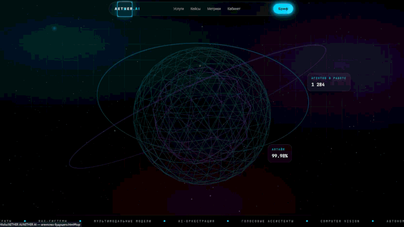
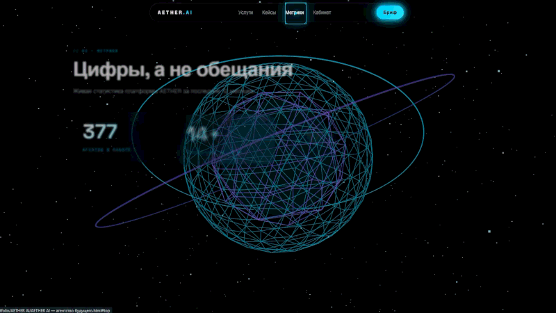
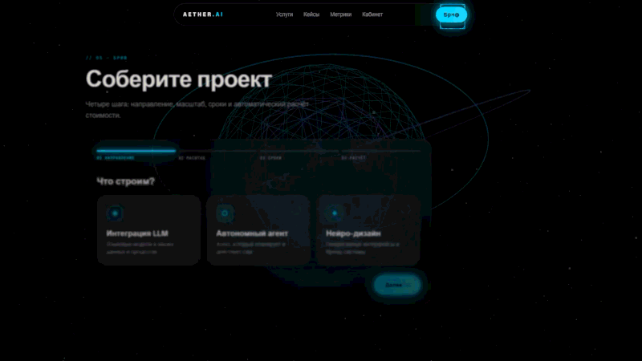

# ◈ AETHER AI

### Агентство автономного интеллекта. Интерфейс из будущего.

---

## 01 // О проекте

**AETHER AI** — вымышленное агентство будущего, которое проектирует автономных ИИ-агентов, интегрирует языковые модели в бизнес-процессы и создаёт нейро-дизайн нового поколения. Этот сайт — его цифровая витрина: глубокий космический чёрный фон, стеклянные панели, неоновые свечения, 3D-ядро и интерфейс, который реагирует на каждое движение курсора.

> **Пять экранов в одном файле:** Главная · Услуги · Кейсы · Метрики · Кабинет · Бриф

---

## 02 // Визуальный демонстрационный стенд

  
  
  

<i>▲ Интерактивные зоны AETHER AI: Главный 3D-экран, Bento-кейсы и ИИ-Песочница</i>

### ◉ Главная: ядро AETHER

  

> **Что демонстрируется:** интерактивная 3D-сфера (двойной wireframe, орбитальные кольца, облако из 900 частиц), которая плавно следует за курсором. Кинематографичный вход текста с эффектом расшифровки (scramble), «магнитные» кнопки, притягивающиеся к указателю, и кастомный HUD-курсор, меняющий форму над интерактивными элементами.

---

### ◉ Кейсы: проекты в орбите

  

> **Что демонстрируется:** галерея с генеративными SVG-обложками и двухслойным параллаксом от движения мыши, плавным масштабированием и неоновым свечением при наведении. Клик открывает стеклянное модальное окно с блоками «Задача», «Стек технологий» и «Результат работы ИИ». Закрытие по Esc, клику на фон или кнопке.

---

### ◉ Кабинет: ИИ-песочница

  

> **Что демонстрируется:** футуристичное поле ввода промпта, пресеты и кнопка «Запустить симуляцию». Затем на 2 секунды включается «мыслительный процесс» ИИ: бегущий прогресс-бар, лоадер и терминальные строки с эффектом расшифровки. В финале появляется структурированный отчёт: резюме, план внедрения, риски и рекомендуемый стек.

---

### ◉ Бриф: геймифицированный конструктор

  

> **Что демонстрируется:** четырёхшаговый квиз с анимированными переходами: направление → масштаб → сроки и пакет → итог. Стоимость проекта считается на лету и анимированно «набегает». При отправке запускается HUD-эффект: сканирующие кольца, прорисовка галочки и расшифровка статуса «СИГНАЛ ПРИНЯТ».

---

## 03 // Технологический стэк

| Категория | Технология / Библиотека | Роль в проекте (За что отвечает) |
| :--- | :--- | :--- |
| **Core** | React 18.3 + Babel Standalone (CDN) | Компонентная архитектура и управление состоянием интерфейса. JSX компилируется прямо в браузере, поэтому сборка не нужна |
| **3D Graphics** | Pure Three.js (r128) | Интерактивная 3D-сфера: wireframe-геометрия, кольца, частицы, параллакс от курсора. Написана без обёрток, на чистом API |
| **Styles** | Tailwind CSS 3.4 (CDN) + Custom CSS | Дизайн-система: палитра, неоновые тени, анимации, glassmorphism, Bento-сетка, адаптивная вёрстка |
| **Icons** | Unicode-глифы + inline SVG | Иконки сервисов и HUD-элементы без внешних зависимостей. В полноценной Next.js-версии архитектуры предусмотрен Lucide React |
| **Typography** | Space Grotesk + JetBrains Mono | Заголовочный и моноширинный HUD-шрифты через Google Fonts |

---

## 04 // Ключевые фичи (Инженеринг)

### ⚡ Оптимизация Three.js

- **Пауза рендера вне видимости.** `IntersectionObserver` отслеживает canvas: когда сфера не в зоне видимости, цикл не вызывает `renderer.render()` и не тратит ресурсы GPU. Фоновые вкладки браузер дополнительно замораживает на уровне `requestAnimationFrame`.
- **Ограничение плотности пикселей.** `setPixelRatio(Math.min(devicePixelRatio, 2))` сохраняет чёткость на Retina-экранах без лишней нагрузки на видеокарту.
- **Полная очистка памяти.** При размонтировании вызываются `dispose()` для всех геометрий и материалов, отключаются наблюдатели и слушатели событий.
- **Адаптивный размер холста.** `ResizeObserver` пересчитывает камеру и рендерер без перезагрузки сцены.
- **Плавный старт.** Пока сцена инициализируется, показывается лоадер, затем сфера появляется с fade-in.

### 🧠 Управление состоянием без перезагрузки 3D

- **Сфера монтируется один раз** на уровне корня приложения и живёт в фиксированном слое под интерфейсом.
- **Переключение вкладок не пересоздаёт сцену.** Меняется только состояние `tab`: на главной сфера яркая, на остальных страницах плавно приглушается до 30% прозрачности и остаётся фоном.
- **Локальное состояние компонентов.** Квиз брифа, песочница, модальные окна и счётчики изолированы в своих компонентах и не вызывают лишних перерисовок.
- **Таймеры под контролем.** Все `setTimeout` и `requestAnimationFrame` очищаются при размонтировании.

### 📱 Адаптивность и Bento-сетка

- **Bento-сетка перестраивается от 4 колонок до одной.** Карточки разной ширины и высоты на десктопе складываются в аккуратную колонку на смартфоне.
- **Нижняя навигация для мобильных.** Верхнее меню скрывается на узких экранах, а удобная «плавающая» панель учитывает безопасные зоны iOS (`safe-area-inset`).
- **Масштабируемая типографика.** Заголовки используют `clamp()` и адаптивные размеры, поэтому длинные слова не ломают вёрстку.
- **Поля ввода по 16 px.** Это предотвращает нежелательный автозум страницы в iOS Safari при фокусе.
- **Уважение к настройкам системы.** Поддержка `prefers-reduced-motion` отключает тяжёлые анимации для пользователей, которые об этом просят.

### 🎛 HUD-эффекты и микроинтерактивы

- **Кастомный HUD-курсор.** Точка следует за указателем мгновенно, кольцо с инерцией (lerp). Над кнопками и карточками оно превращается в квадрат с угловыми скобками. Позиция обновляется через `ref` и `requestAnimationFrame`, без ре-рендеров React. На тач-устройствах курсор автоматически отключается.
- **Spotlight на Bento-карточках.** Подсветка и светящаяся граница следуют за курсором через CSS-переменные `--mx` и `--my`.
- **Магнитные кнопки.** Элементы притягиваются к курсору и плавно возвращаются на место.
- **Scramble-текст.** Эффект расшифровки в заголовках, терминалах и статусах.
- **Cinematic-слой.** Film grain, сканирующая линия, анимированная сетка и аврора-градиенты.
- **HUD-экран успешной отправки.** Пульсирующие кольца, вращающиеся пунктирные орбиты и прорисовываемая галочка.

**AETHER AI** 

